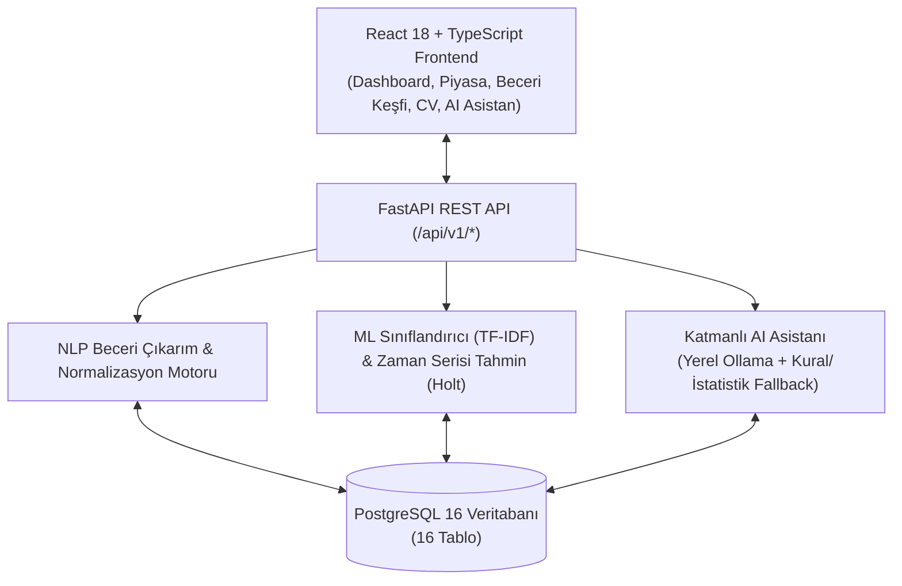

<div align="center">

# 🎯 SkillScope AI

**Yapay Zekâ Destekli İş Piyasası Analiz ve Kariyer Zekâ Platformu**

[](#lisans)
[](https://www.python.org/)
[](https://fastapi.tiangolo.com/)
[](https://react.dev/)
[](https://www.postgresql.org/)
[-10B981.svg)](#sıfır-bütçe-mimarisi)

</div>

---

## 1. Proje Açıklaması ve Çözdüğü Problem

İş arayan öğrenciler, yeni mezunlar ve kariyerini geliştirmek isteyen profesyoneller; hangi becerilerin talep gördüğünü, hangi teknolojilerin hangi şehir ve sektörlerde öne çıktığını ve hedefledikleri meslekler için hangi yetkinliklere ihtiyaç duyduklarını dağınık iş ilanları yüzünden net biçimde görememektedir.

**SkillScope AI**, iş ilanlarını yapılandırılmış analitiğe, makine öğrenmesi tahminlerine, gizlilik odaklı CV-pozisyon eşleştirmesine ve ücretsiz kaynaklara dayalı kişisel kariyer yol haritalarına dönüştürür.

---

## 2. Temel Özellikler

1. **Esnek CSV İçe Aktarma ve Veri Doğrulama:** Farklı sütun adlarını (`ilan_basligi` -> `job_title`, `sehir` -> `location`) otomatik eşleştirir, SHA-256 parmak iziyle mükerrer (duplicate) ilanları engeller.
2. **Yönetilebilir Türkçe/İngilizce NLP Beceri Çıkarımı:** 36+ temel teknoloji ve iş becerisini büyük/küçük harf duyarsız, Türkçe ek toleranslı (`SQL'de`, `PowerBI` -> `Power BI`) olarak ilanlardan ve CV'lerden çıkarır.
3. **İş Piyasası ve Birliktelik (Co-occurrence) Analizi:** Şehir, pozisyon, sektör, çalışma şekli ve tarih aralığına göre beceri sıklıklarını, maaş aralıklarını ve bir beceriyle birlikte en çok aranan tamamlayıcı becerileri hesaplar.
4. **Gerçek Makine Öğrenmesi Modelleri (`Scikit-learn` & `Statsmodels`):**
   - **Beceri Talep Tahmini:** Zamana dayalı eğitim/test ayrımı (Temporal Split), `MAE` ve `RMSE` metrikleri ve %90 güven aralığı ile aylık talep tahmini üretir. Veri yetersizse tahmin özelliğini otomatik kapatır.
   - **İş İlanı Sınıflandırma:** TF-IDF + Lojistik Regresyon ile ilanları 7 kategoriye ayırır (`Accuracy`, `Precision`, `Recall`, `F1-Score`).
5. **Gizlilik Odaklı PDF CV Analizi:** PDF CV'yi diske kaydetmeden bellekte (`BytesIO`) işler, eğitim/deneyim/becerileri çıkarır, hedef pozisyonla karşılaştırır ve kullanıcıya tek tıkla silme imkânı sunar.
6. **Kişiselleştirilmiş Kariyer Yol Haritası:** Kullanıcının seviyesi, hedef mesleği, mevcut becerileri ve haftalık çalışma süresine göre önkoşul grafiğini ve ilanlardaki talep sıklığını dikkate alan aşamalı öğrenme planı üretir.
7. **Katmanlı AI Kariyer Asistanı (Ollama + Kural/İstatistik Fallback):** Yerel Ollama açıksa yerel LLM ile, kapalıysa veritabanı analiz fonksiyonlarını kullanan Kural/İstatistik motoruyla veri dönemi ve örneklem büyüklüğünü belirterek yanıt verir.

---

## 3. Teknoloji Yığını (Sıfır Bütçe)

| Katman | Teknolojiler | Lisans |
| :--- | :--- | :--- |
| **Backend** | Python 3.11, FastAPI, SQLAlchemy 2.0, Pydantic v2, Alembic | MIT |
| **Veritabanı** | PostgreSQL 16 (16 ilişkisel tablo) | PostgreSQL License |
| **Veri Bilimi & ML** | Pandas, NumPy, Scikit-learn, Statsmodels, Joblib, PyPDF | BSD-3-Clause |
| **Yapay Zekâ** | Opsiyonel Ollama (`gemma3:1b` vb.) + Kural & Retrieval Tabanlı Analitik Motor | MIT |
| **Frontend** | React 18, TypeScript, Vite, Tailwind CSS, Recharts, Lucide Icons | MIT |
| **Test & Kalite** | Pytest, HTTPX, Vitest, React Testing Library | MIT |
| **Altyapı** | Docker, Docker Compose, GitHub Actions CI | Apache-2.0 / MIT |

---

## 4. Mimari Şema



---

## 5. Kurulum ve Docker ile Çalıştırma (Windows 11 PowerShell)

### Önkoşullar
- Docker Desktop (çalışır durumda)
- Git

### 1. Ortam Dosyasını Hazırlayın
```powershell
Copy-Item .env.example .env
```

### 2. Docker Compose ile Tüm Servisleri Başlatın
```powershell
docker compose up --build
```
Arka planda çalıştırmak için:
```powershell
docker compose up --build -d
```

### 3. Servis Loglarını İzleme ve Durdurma
```powershell
docker compose logs -f
docker compose down
```

### 4. İlk Çalıştırmada Otomatik Migration ve Demo Veri Yükleme
Backend konteyneri ayağa kalktığında (`AUTO_SEED_DEMO_DATA=true`):
1. PostgreSQL üzerinde 16 tabloyu ve indeksleri oluşturur (`migrations/versions/0001_initial_schema.py`).
2. 36 becerilik Türkçe/İngilizce beceri sözlüğünü yükler.
3. Açıkça **`SYNTHETIC_DEMO`** olarak etiketlenmiş 72 adet örnek iş ilanını (`data/sample/demo_jobs_tr.csv`) içe aktarır ve ML modellerini eğitir.

Manuel olarak veritabanını başlatmak veya demo veriyi sıfırlamak isterseniz:
```powershell
docker compose exec backend python /app/../scripts/init_db_and_seed.py
```

### Erişim Adresleri
- **Web Uygulaması (Frontend):** `http://localhost:5173`
- **Backend REST API:** `http://localhost:8000/api/v1/health`
- **Swagger API Dokümantasyonu:** `http://localhost:8000/docs`

---

## 6. Testlerin Çalıştırılması

### Backend Testleri (Pytest)
```powershell
docker compose exec backend pytest -v
```

### Frontend Testleri (Vitest)
```powershell
cd frontend
npm run test -- --run
```

---

## 7. Veri Kaynakları, Güvenlik ve Bilinen Sınırlılıklar

- **İzinsiz Veri Çekmeme:** LinkedIn, Kariyer.net, Indeed vb. sitelerden izinsiz scraping yapılmaz.
- **Şeffaf Demo Verisi:** Başlangıç verileri `SYNTHETIC_DEMO` olarak işaretlenmiştir; gerçek tahmin başarısı iddiasında kullanılmaz ve arayüzden tek tıkla silinebilir.
- **CV Gizliliği:** PDF CV dosyaları diske kalıcı kaydedilmez, loglara yazılmaz ve dış LLM servislerine gönderilmez.
- **Metodolojik Sınırlılık:** CV eşleşme yüzdesi işe alınma olasılığı değil, incelenen ilanlardaki teknik becerilerle ağırlıklı örtüşme oranıdır.

---

## 8. Katkıda Bulunma ve Lisans

Katkıda bulunmak için yeni bir dal (branch) açıp testlerin (`pytest` ve `vitest`) geçtiğinden emin olduktan sonra Pull Request gönderebilirsiniz. Bu proje **MIT Lisansı** altında lisanslanmıştır (`LICENSE`).
