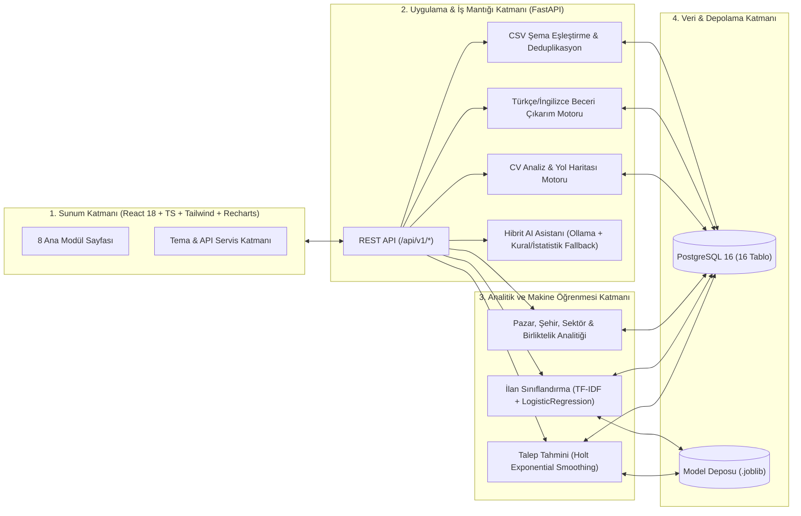

# SkillScope AI — Teknik Mimari Dokümanı (`docs/architecture.md`)

## 1. Genel Bakış

SkillScope AI, iş piyasasındaki dağınık iş ilanı metinlerini anlamlandıran, aranan becerileri NLP ile çıkaran, zaman serisi talep tahmini ve ilan sınıflandırması yapan, PDF CV'leri hedef pozisyonlarla karşılaştıran ve veriye dayalı bir AI asistanı sunan uçtan uca bir kariyer zekâ platformudur.

Tüm sistem **sıfır zorunlu ücretli API maliyeti** prensibiyle tasarlanmıştır.

## 2. Mimari Katmanlar

## 3. Servisler Arası İletişim ve Güvenlik

- **Docker Compose Ağı (`skillscope_network`):** `postgres`, `backend` ve `frontend` servisleri izole bridge ağında haberleşir.
- **Healthcheck Bağımlılığı:** PostgreSQL `pg_isready` kontrolünden geçmeden `backend` başlamaz; `backend` `/api/v1/health` kontrolünden geçmeden `frontend` trafiği açılmaz.
- **Gizlilik Odaklı CV İşleme:** Yüklenen PDF dosyaları diske yazılmadan `io.BytesIO` ile bellekte ayrıştırılır; CV metinleri loglanmaz ve harici servislere gönderilmez.
